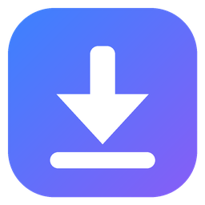

<p align="center"></p>

<h1 align="center">Baixador</h1>

<p align="center">Cole o link e baixe o vídeo — <b>YouTube</b>, <b>Instagram</b>, <b>TikTok</b> e <b>Facebook</b>.<br>
App de Windows, sem anúncio, tudo rodando no seu computador.</p>

---

## Como usar
1. Baixe o **`Baixador.zip`** da [última versão](https://github.com/rafaguiar-dev/baixador/releases/latest).
2. Descompacte numa pasta (ex.: `Documentos\Baixador`) e abra o **`Baixador.exe`**.
3. Copie o link do vídeo (botão **Compartilhar → Copiar link**) e cole no app.
4. Ele reconhece a rede e mostra as qualidades disponíveis (até 4K no YouTube) e a opção **Só o áudio (MP3)**.
   Clique em **Baixar**.

Os arquivos vão para `Downloads\Baixador` (dá pra trocar no rodapé).

> Na primeira vez o Windows pode mostrar "O Windows protegeu o computador" (o app não tem assinatura digital).
> Clique em **Mais informações → Executar assim mesmo**.

## O que ele baixa
| Rede | O quê |
|---|---|
| YouTube | Vídeos e Shorts, de 144p a 4K, ou só o áudio em MP3 |
| Instagram | Reels, vídeos e posts com vários itens (públicos) |
| TikTok | Vídeos sem marca d'água, ou só o áudio |
| Facebook | Vídeos e Reels públicos (SD/HD) |

Conteúdo **privado** ou que pede login (perfil fechado, stories, grupos) não é baixado.

## Atualização automática
Toda vez que abre, o Baixador confere se tem versão nova aqui no GitHub. Se tiver, aparece um aviso no topo:
**Atualizar agora** baixa a versão nova, instala e abre o app de novo. **Agora não** deixa pra próxima.
As redes mudam com frequência, então manter atualizado é o que faz ele continuar funcionando.

## Requisitos
- Windows 10 ou 11 (64 bits) com o **Microsoft Edge WebView2** (já vem no Windows atualizado).

## Para desenvolver
```
uv venv --python 3.11 .venv
uv pip install --python .venv\Scripts\python.exe -r requisitos.txt
.venv\Scripts\python app.py              # abre a janela
.venv\Scripts\python app.py --web 8830   # mesma tela no navegador
.venv\Scripts\python motor.py <link>     # lista as opções pela linha de comando
```
Precisa de `ffmpeg`/`ffprobe` e de **Node.js** (o YouTube exige um runtime de JavaScript) no PATH.

**Arquivos:** `motor.py` (reconhece a rede, lista e baixa, com [yt-dlp](https://github.com/yt-dlp/yt-dlp)) ·
`app.py` (janela com [pywebview](https://pywebview.flowrl.com/)) · `ui/index.html` (a tela) ·
`atualizador.py` (atualização pelo GitHub Releases) · `empacotar.py` (gera o .exe) · `icone.py` (ícone).

### Publicar uma versão nova
1. Suba `VERSAO` em `app.py` (ex.: `1.0.1`).
2. `.venv\Scripts\python empacotar.py` → gera `dist\Baixador.zip` e `dist\Baixador-atualizacao.zip`.
3. Crie a release com a tag `v1.0.1` e anexe os **dois** zips:
   ```
   gh release create v1.0.1 dist\Baixador.zip dist\Baixador-atualizacao.zip --title "Baixador 1.0.1" --notes "O que mudou..."
   ```
   O app instalado vê a release nova na próxima vez que abrir. O `Baixador-atualizacao.zip` (sem ffmpeg/Node) é o que
   ele baixa normalmente; o completo fica pra quem instala do zero.

## Uso responsável
Baixe só o que você tem direito de baixar: seus próprios vídeos, conteúdo com licença livre ou para uso pessoal
permitido. Respeite os direitos autorais dos criadores e os termos de uso de cada plataforma. Este projeto não tem
relação com YouTube, Instagram, TikTok ou Facebook; as marcas aparecem só para indicar compatibilidade.

## Licença
Código sob [MIT](LICENSE). O pacote do Windows inclui programas de terceiros, cada um com a sua licença:
[yt-dlp](https://github.com/yt-dlp/yt-dlp) (Unlicense),
[FFmpeg](https://ffmpeg.org) (GPL — build "essentials" de [gyan.dev](https://www.gyan.dev/ffmpeg/builds/), código-fonte em
[ffmpeg.org](https://ffmpeg.org/download.html#get-sources)),
[Node.js](https://nodejs.org) (MIT) e [pywebview](https://github.com/r0x0r/pywebview) (BSD).
